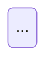

# PR description

A PR description is read three times:
- by the reviewer deciding whether to open the diff;
- by the person six weeks later asking why the game behaves like this;
- by whoever searches merged PRs for the reason behind a change.

Write for all three. Put the high-level view first and a picture before a paragraph. Leave the mechanism at the bottom, where only the reviewer scrolls.

iso-hoops is a browser game: plain ES modules in `dist/`, no build step, tests run with `node --test`. Nearly every change is visible, so a description without a picture or clip is a claim the reader has to take on trust. This skill makes the evidence.

## Workflow

1. **Read the change against `origin/main`.**
   - Run `git fetch origin` first. A local `main` can sit commits behind, and comparing against it lists already-merged work and photographs an old "before".
   - `git log --oneline origin/main..HEAD` and `git diff origin/main...HEAD` show committed work.
   - `git diff HEAD` shows uncommitted edits. When HEAD equals `origin/main`, this is the whole change.
   - `git status --short` lists untracked files (`??`), which no diff shows. Read new files directly.
   - Read any linked issue, and the conversation, for the why.
   - Decide which template from `references/templates.md` fits. Read only that one.
2. **Check the branch is shippable.**
   - Not on `main`. If you are, branch first: `git switch -c <short-kebab-name>`.
   - `node --test` passes.
   - Every `dist/` file changed and referenced from `dist/index.html` has its `?v=` bumped. Modules imported with `?v=` count too, such as `./courts.js?v=4`. This is the README's deploy rule, and stale query strings ship old code to players.
   - Uncommitted work is either committed with a message in the repo's style (see `git log`) or deliberately left out. Ask if unclear.
   - Agent tooling under `.claude/` (skills, `launch.json`) is not part of a game change. Leave it out of the commit unless the user says it belongs in this PR. If it does, give it its own PR or its own 🛠️ section.
3. **Capture media.** Follow [Capturing media](#capturing-media): before/after PNGs, plus one MP4 + GIF for anything that moves.
4. **Write the title and body.** Follow [Title](#title) and [What every body carries](#what-every-body-carries). Write the body to `<media dir>/body.md`, next to the media. gh resolves relative image paths from the body file's folder.
5. **Show the user before pushing.** Give them the title, the body path and the media list. Pushing and opening a PR are visible to others, so get a yes first, unless the user has already said to open it.
   - Also tell them anything the captures revealed that the PR didn't intend, such as a wrapped separator, an overlap or a console error. Say it in your message, not only under Risks, so they can fix it first.
6. **Push and open (or update).**
   ```bash
   git push -u origin HEAD
   gh pr create --base main --title "<title>" --body-file "$MEDIA/body.md" \
     --attach "$MEDIA/after.png" --attach "$MEDIA/before.png" \
     --attach "$MEDIA/<clip>.mp4" --attach "$MEDIA/<clip>.gif"
   ```
   - If the branch already has a PR (`gh pr view --json number,url`), use `gh pr edit <number> --title … --body-file … --attach …` instead.
   - Pass every referenced file once, and nothing else: no scenario JSONs, no check frames. gh rewrites each local reference to the uploaded URL. Any file you attach but don't reference is appended to the end of the body.
   - The alt text written in the Markdown is kept, so a plain `--attach "$MEDIA/after.png"` is enough. Skip the `#alt` suffix and its quoting.
7. **Verify, then clean up.**
   - Run `gh pr view --json body -q .body | grep -c 'user-attachments'`. It should count one URL per attached file.
   - Also check that no `](./` local paths remain.
   - Only then run `rm -rf "$MEDIA"`. If any upload failed, keep the folder, say which file failed, and retry with `gh pr edit --attach`.
8. **Report** the PR URL, and what the reviewer should look at first.

## Title

A title says what a player now gets, not what the diff did. Use plain sentence case, no `feat:` prefix, under about 70 characters.

- ✅ "Night court: play under floodlights, with a buzzing hum"
- ✅ "Pausing mid-flight no longer drops the ball through the floor"
- ❌ "feat(game): add night court"
- ❌ "Update game.js and style.css"

## What every body carries

**A summary first, before anything else.** It's the whole PR for someone who reads nothing further: a reviewer triaging their queue, or someone scanning merged PRs months later.
- Use a bold **Summary** label and two to four bullets. Give one bullet per headline change, the fixes and tooling included, so nothing in the PR is a surprise further down.
- Each bullet is one plain sentence about what a player or maintainer now gets. Put no file paths, numbers of tests or mechanism here.
- If the PR needs one thing from the reviewer, such as "check the phone layout" or "decide on the default", make it the last bullet.

```markdown
**Summary**

- A new night court, with floodlights, long shadows and a low buzzing hum.
- Pausing mid-flight no longer drops the ball through the floor.
- Please check the floodlight glare on a phone; it's the part I'm least sure of.
```

**A table of contents next**, with one link per `##` section, so the reader can click straight to the part they want.
- GitHub gives headings in a PR body no anchors you can rely on.
- So end every linked heading with `<a id="slug"></a>`, and link to `#user-content-slug`. GitHub prefixes user ids with `user-content-`.
- A dead TOC is worse than none, so give every section an id.
- Write it as a bulleted list under a bold **Contents** label, one link per line, in the same order as the sections. A list scans down the page faster than a run of links wrapping across one line, and a reviewer can see at a glance how many sections there are. Leave a blank line after the list, before the first heading.

```markdown
**Contents**

- [At a glance](#user-content-glance)
- [What changes](#user-content-changes)
- [Screenshots](#user-content-shots)
- [How it works](#user-content-diagram)
- [Risks](#user-content-risks)
- [Technical overview](#user-content-tech)

## At a glance <a id="glance"></a>
```

**At a glance.**
- Show the GIF, if there is one. It autoplays, so a skimmer sees the change without clicking anything.
- Add one sentence on what the clip shows. Don't repeat the summary: that already said what changed, and this section shows it.

**Categories a reader can scan.**
- Group by player benefit, such as `## 🎯 A goal to chase` or `## 🧭 Settings you can find`. For housekeeping PRs, group by change class: ✨ Feature · 🐛 Fix · 💄 Polish · ♿ Accessibility · ⚡ Performance · 📝 Docs · 🧪 Tests · ♻️ Refactor.
- Use one emoji per heading, and none on bullets.
- A fix to the feature this PR adds goes under that feature's section. Changes unrelated to the headline go in change-class sections after the benefit sections.
- Inside a section, each bullet is a bold hook and a dash, then two to four indented sub-bullets of one fact each.
  - Put the key or control in backticks (`Space`).
  - Give a menu path as Footer › Mode › 10 free throws.
  - Or state a behaviour.
- Never write a paragraph inside a section. If a bullet needs more than four facts, split it.
- When the change touches something players like, add one bullet saying what stayed the same. Check that claim against the diff: "untouched" is the line reviewers catch.
- Credit contributors inline: "Thanks @handle (#NN)".
- Above Risks, use no file paths, function names or line numbers. Risks and the technical overview are for the reviewer, so they may name tests and files.

**Screenshots of the change.**
- Include at least one PNG of the screen after the change.
- Add a before/after pair when the change replaces something, laid out as a two-column table so they sit side by side.
- Crop to the part that changed. A footer change shows the footer, not the whole court.
- Keep crops under about 4:1. For a full-width bar, crop an inner element (`.settings`, not `.footer`) or take that shot at a narrower viewport. A 5000×200 strip renders as a sliver on GitHub.
- Video is covered under [Capturing media](#capturing-media).
- A change with nothing to see, such as a test-only or tooling PR, shows terminal output in a fenced block instead and says why there is no screenshot.

```markdown
| Before | After |
| --- | --- |
|  |  |
```

**A mermaid diagram of the change**, in a ` ```mermaid ` fence, which GitHub renders inline.
- Draw the change, not the whole game: the new flow, the state that moved, the modules touched.
- Shapes that fit most PRs here:
  - `stateDiagram-v2` for game flow, such as a round's lifecycle or a shot's outcome.
  - `flowchart` for UI and data flow, or which module now owns what.
  - `sequenceDiagram` for timing, such as load order, a skeleton clearing or audio unlocking.

**Risks.** Write them in the order a reviewer worries:
1. Can this break the game for players: a crash, a stuck state, a wrong score?
2. Can it break the deploy: stale `?v=`, missing files in `dist/`?
3. Layout on phone and tablet widths.
4. Accessibility: focus, labels, reduced motion.
5. Saved state: localStorage keys added, renamed or reinterpreted.

For each risk, give the check that covers it ("measured at 375, 820, 1000 and 1440px wide"). If nothing checks it, say so plainly.

**Technical overview**, last before any notes. It's for the reviewer:
- the mechanism in a few sentences;
- the files that matter, with a clause each;
- the approach you rejected that they would ask about;
- the gate, for example "`node --test`: 22 pass, 0 fail".

Everything above this section stays high level.

**Attribution.** End with any attribution line your environment asks for.

## Capturing media

`scripts/capture.mjs` drives headless Chrome over the DevTools protocol, with no npm install. It needs Node 22+, Google Chrome (or `CHROME=/path`) and ffmpeg.
- It serves the folder you pass on its own free port, so it never clashes with a dev server that's already running.
- It writes PNGs at 2x, and turns each recording into an MP4 and a GIF.

**Set up a media folder** outside the repo, so nothing gets committed by accident:

```bash
MEDIA=$(mktemp -d)/pr-media && mkdir -p "$MEDIA/scenarios" "$MEDIA/checks"
```

Scenarios go in `$MEDIA/scenarios/`, and frames you extract to check a clip go in `$MEDIA/checks/`. Only media the body references sits at the top level, which keeps the attach list obvious.

**After** shots come from the working tree:

```bash
node .claude/skills/pr-description/scripts/capture.mjs --dir dist --scenario "$MEDIA/scenarios/after.json" --out "$MEDIA"
```

**Before** shots come from `origin/main` (fetched in step 1), checked out to a throwaway worktree:

```bash
BASE=$(mktemp -d)/base && git worktree add --detach "$BASE" origin/main
node .claude/skills/pr-description/scripts/capture.mjs --dir "$BASE/dist" --scenario "$MEDIA/scenarios/before.json" --out "$MEDIA"
git worktree remove --force "$BASE"
```

A before scenario runs against the old code, so it can't wait for selectors or storage keys the PR adds. Use a plain `{ "wait": 800 }`, or an element that already existed.

**The scenario** is a JSON file you write for each PR. It drives the page to the state worth showing:

```json
{
  "viewport": [1440, 900],
  "scale": 2,
  "storage": { "iso-hoops:mode": "free-throws", "iso-hoops:sound-mode": "off" },
  "steps": [
    { "waitFor": "document.querySelector('.settings.ready')" },
    { "wait": 500 },
    { "screenshot": "after.png" },
    { "screenshot": "after-footer.png", "selector": ".settings", "pad": 24 },
    { "record": "free-throw", "steps": [
      { "wait": 300 },
      { "key": "Space", "hold": 620 },
      { "wait": 2600 }
    ] }
  ]
}
```

**Steps:**

| Step | Fields |
| --- | --- |
| Wait | `wait` (ms), or `waitFor` (a JS expression) with an optional `timeout` |
| Interact | `click` (a CSS selector), `key` (`Space`, `Escape`, `KeyW`, arrows…) with `hold` (ms), or `eval` (any JS) |
| Screenshot | `screenshot` (a file name); add `selector` and `pad` to crop |
| Record | `record` (a base name) with nested `steps`; writes `<name>.mp4` and `<name>.gif` |

**Scenario notes:**
- `storage` sets localStorage before the page loads. That's how to open straight into a mode, court or sound setting, and how to seed realistic saved state: a best score of 7 reads better than 00. The keys live in `dist/game.js`; grep for `iso-hoops:`.
- Turn sound off. It's muted anyway, and it skips the audio-unlock path.
- Wait for the page to be ready before shooting, for example `.settings.ready` or the canvas having drawn, so no skeleton or blank frame lands in the PR.
- The viewport is set once per scenario, so a phone shot needs its own scenario file with `"viewport": [375, 812]`, which also switches on mobile emulation. Add one whenever layout changed.
- Free throws: holding `Space` for about 620ms from the free throw spot lands near the middle of the target band, and a 60ms tap misses. Use these to stage a make or a miss on purpose.
- Keep clips to 3–6 seconds of the one action that matters. The script prints each file's size and warns over GitHub's 10 MB limit. If you get the warning, shorten the clip, or lower `gifWidth` and `gifFps` on the record step (defaults 720 and 12).

**Look at every image before using it.** Open the PNGs, and pull a few frames from each MP4 into `$MEDIA/checks/`, for example `ffmpeg -ss 1 -i "$MEDIA/clip.mp4" -frames:v 1 "$MEDIA/checks/clip-1s.png"`. A screenshot of the wrong state is worse than none. Anything odd you spot is a finding for the user (step 5).

**Where video goes:**
- The GIF goes in **At a glance**, because it autoplays.
- The MP4 goes in **Screenshots**, under its own small heading, as `` alone on its own line, with a blank line above and below. That's what makes GitHub render a player rather than a link. Video takes no alt text.
- Images take alt text in the Markdown. Describe what the picture shows, not that it is a screenshot.

## Body skeleton

~~~markdown
**Summary**

- <Headline change, as what a player now gets.>
- <Next change, or the one thing you need from the reviewer.>

**Contents**

- [At a glance](#user-content-glance)
- [<Benefit 1>](#user-content-b1)
- [<Benefit 2>](#user-content-b2)
- [Screenshots](#user-content-shots)
- [How it works](#user-content-diagram)
- [Risks](#user-content-risks)
- [Technical overview](#user-content-tech)

## At a glance <a id="glance"></a>

<One sentence on what the clip shows.>


## 🎯 <Benefit 1> <a id="b1"></a>

- **<Hook>** – <one line>
  - <fact>
  - <fact>

## 🧭 <Benefit 2> <a id="b2"></a>

- **<Hook>** – <one line>
  - <fact>

## Screenshots <a id="shots"></a>

| Before | After |
| --- | --- |
|  |  |

**<Clip name>**


## How it works <a id="diagram"></a>



## Risks <a id="risks"></a>

- **<Risk>** – <how it was checked, or "not checked">

## Technical overview <a id="tech"></a>

<Mechanism in a few sentences.>

- `dist/<file>` – <what changed there>
- **Rejected:** <the approach a reviewer would ask about, and why not>
- **Gate:** `node --test` – <N> pass, 0 fail
~~~

Keep sections that have content and drop the rest, but always keep the summary, At a glance, Screenshots (or its terminal-output stand-in), the diagram, Risks and the Technical overview. Update the TOC to match.
