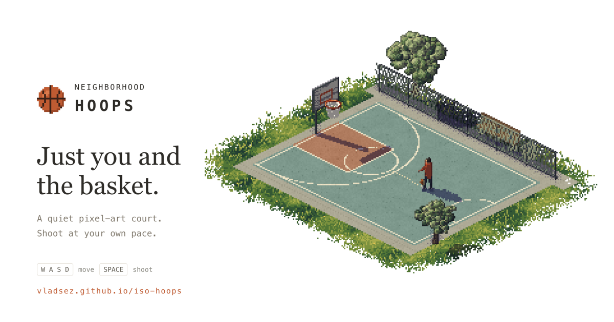

# Neighborhood Hoops

A relaxed 3D pixel-art basketball game that runs in your browser. Move around the court, line up your shot and drain it through the net.

**[Play it here](https://vladsez.github.io/iso-hoops/)**



Built with Claude Opus 5.5 on [Pixel Plays](https://github.com/amirmushichge/pixel-plays)' isometric software renderer. There are no dependencies and no build step.

## Features

- **5 courts:** neighborhood, rooftop, boardwalk beach, autumn park and first snow. Switch between them from the Court menu in the footer.
- **Every court keeps your hours:** each one follows today's sun where you live: morning from first light, day from two hours after sunrise, evening's golden hour from ninety minutes before sunset, and night after dark. The times shift with the seasons and daylight saving, and come from your time zone, never your location. The page takes the colour of the sky, the sun's shadows move, and after dark five streetlights and a floodlight on the hoop light the court under the stars. The clock button in the header shows the phase and today's times, and you can pin one instead of following the sun. The choice is saved.
- **Longest basket:** in free shooting, the header tracks your longest make in metres, measured from where you shot to the hoop. Beat it for a NEW LONGEST callout. It is saved in your browser.
- **10 free throws:** a mode with a goal. Shoot ten from the free throw spot and see how many you make, then step back a little each round, out to the three-point line. Your best round is remembered. Pick it from the Mode menu in the footer.
- **Beat the clock:** free shooting against a 60-second clock. A basket is worth 2 points, or 3 from beyond the arc, and a dunk is worth 2. The clock starts with your first shot, the ball comes back quickly, and the last ten seconds turn red. Your best score is saved.
- **HORSE:** a one-player game of HORSE against the court. A ring marks a spot; walk into it and make the shot. Every miss earns a letter, and spelling H-O-R-S-E ends the game. The spots start at mid-range (4–5 m) and move back every three makes, out beyond the arc. Your best run is saved.
- **3PT contest:** the All-Star three-point contest. Five racks of five balls round the arc plus two deep balls, 60 seconds. Each rack's last ball is a money ball worth 2, one rack of your choice is all money balls, and the deep balls are worth 3, for 40 at most. Your best score is saved.
- **Results:** every mode with an ending shows a card when the round is over: the shot-by-shot story (each rack's balls, a shot chart of the clock round, with makes by zone and a tab for the 60-second timeline, ten free throws in a row, or how far out the HORSE spots moved and where each letter came from) and a few numbers, such as accuracy and your longest make.
- **Dunks:** in free shooting and beat the clock, run at the rim and press Shoot from within about 4 m, or hold Shoot from further out and the dunk starts once you're in reach. There is no meter: you carry on running, gather and rise, and one of seven dunks plays at random, never the same one twice in a row: a two-hand slam, a tomahawk, a quick flush, a hang and swing on the rim, a windmill, a 360, or a reverse that leaves you hanging with your back to the rim. Standing still within about 3 m works too, in front of the rim or from the side: you jump from where you stand. The rim bends under your weight and springs back. A dunk counts as a make (2 points against the clock) but never as your longest basket. With reduced motion turned on, the ball just drops through.
- **Real shot physics:** the ball can bounce off the rim and the backboard. A basket counts only when the ball drops down through the hoop.
- **Music written in code:** a quiet, original 76 BPM loop built sample by sample, with no audio files.
- **Sound effects made on the fly:** dribbles, swishes, the scoring chime and the clang of a dunk on the rim are all generated with the Web Audio API.
- **Made-shot feedback:** the net animates, a basket callout appears and the made count pulses.
- **Remembers your settings:** your court and sound choices are kept between visits.
- **Plays on phones:** an on-screen stick and Shoot button replace the keyboard, with layouts for portrait and landscape.
- **Plays offline:** after your first visit, the game loads without an internet connection. See [Play offline](#play-offline) to install it like an app.
- **Accessible motion:** with reduced motion turned on, the net and callout stay still.

## Controls

| Action | Input |
| --- | --- |
| Move | WASD or arrow keys (relative to the screen) |
| Aim | Mouse, or Q / E to turn |
| Shoot | Hold Space or the left mouse button to build power, release to shoot |
| Cancel a shot or pause | Escape |

In 10 free throws mode your spot and aim are locked, starting at the free throw line. Release inside the dark band on the meter, which wobbles slightly, so time your release. After your tenth shot, Space starts the next round a step farther back, from 5.5 m, then 6 m, then the three-point line.

Beat the clock plays like free shooting: move and aim anywhere. Points go by where you release the shot, 3 from beyond the arc (more than 6.7 m from the hoop, or past the straight corner lines 5.8 m to either side near the baseline) and 2 anywhere else, the line included. A shot still in the air at the buzzer counts if it goes in. When time is up, Space (or Shoot) resets the score and the next shot starts a new 60 seconds. Pausing with Escape or opening How to play stops the clock.

In HORSE you move and aim freely too, but you can only shoot from inside the ring, which turns white once you're in it. Your feet stay planted while you charge. Each shot, made or missed, calls a new spot. After H-O-R-S-E, Space (or Shoot) starts a new game.

In the 3PT contest you're moved from rack to rack and always face the rim, so the shot is all timing: release inside the band on the meter, and watch the arc while you charge. The next ball is ready while the last is still in the air. Before your first shot, pick the money rack with ← → or 1–5, or by clicking or tapping a rack. The clock starts with your first shot and the contest ends when time runs out or the racks are empty.

On phones and tablets, drag the stick in the bottom left to move. You keep facing the rim as you walk; tap or drag on the court to aim elsewhere, or hold the ↺ / ↻ buttons to turn a little. Tap near the rim to aim back at it. Hold the Shoot button to charge. Both portrait and landscape work.

The ball comes back to you after every shot. In free shooting, click or tap the scoreboard to see the session on a court: every shot where you took it, and makes in the paint, mid-range and from three. Start over there clears the session. Free shooting stats also reset when you reload the page, except your longest basket. Your best free throw round, your best against the clock, your best HORSE game and your best 3PT contest are saved in your browser too.

## Play offline

Open the game once while online. Everything it needs is saved, and from then on it loads without an internet connection, saved bests included. To keep it a tap away, install it:

- **Chrome or Edge on a computer:** click Install in the address bar, or in the browser menu.
- **Safari on a Mac:** File › Add to Dock.
- **iPhone or iPad:** tap Share, then Add to Home Screen.
- **Android:** open the browser menu and tap Install app or Add to Home screen.

The installed game opens full screen, without the browser bars. The How to play dialog, behind the ? button, has the same steps.

## Sound

Sound is on by default. Browsers that block autoplay start the audio on your first click or keypress. Use the sound menu in the footer to turn off just the music or all sound.

## Run locally

```sh
node serve.mjs
```

Then open http://127.0.0.1:5300.

The offline service worker (`dist/sw.js`) doesn't register on `localhost` or `127.0.0.1`, so your edits always show up. Its `FILES` list must match what the page loads, `?v=` strings included; the tests check this.

Run the tests with:

```sh
node --test
```

The same tests run on every pull request and every push to `main` (`.github/workflows/test.yml`).

## Deploy to GitHub Pages

GitHub Pages publishes the `gh-pages` branch. When you edit `dist/style.css`, `dist/engine.js` or `dist/game.js` (or a module it imports), bump that file's `?v=` version in `dist/index.html` so browsers fetch the new code.

Deploys are automatic:

- **Production:** every push to `main` publishes `dist` to `gh-pages` (`.github/workflows/deploy.yml`). You can also run it by hand from the Actions tab.
- **PR previews:** every pull request from a branch in this repo is published to `https://vladsez.github.io/iso-hoops/pr-preview/pr-<number>/`, and a comment on the PR links to it with a QR code for phones (`.github/workflows/preview.yml`). The preview is removed when the PR is closed or merged.

Previews share the site's origin, so they also share its saved settings, best scores and longest basket.

## Credits

- `dist/engine.js` comes from [Pixel Plays](https://github.com/amirmushichge/pixel-plays) by AmirMushich, under the MIT license in `dist/LICENSE.pixel-plays`. No Pixel Plays music is used.
- All court, interface, game, physics and audio code was written for this project.
- Made by [@vladsazonau](https://x.com/vladsazonau).
